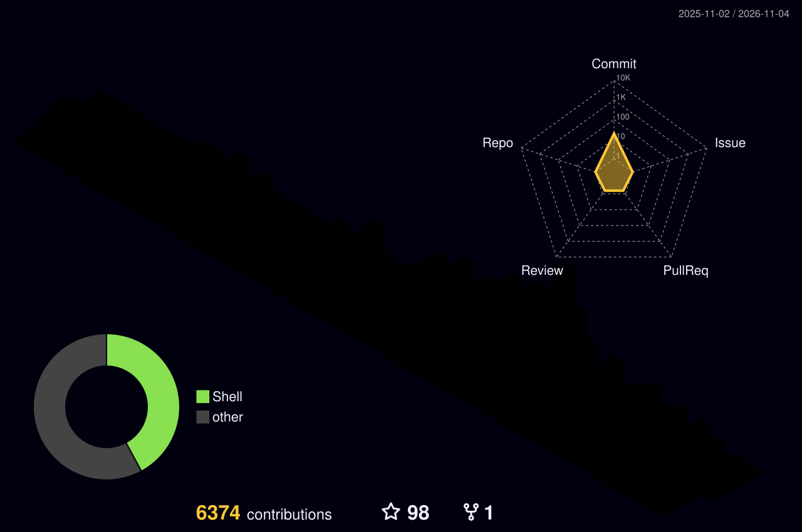

  

  

  <strong>AI 應用開發者</strong> 
  熟悉各類 AI 應用，包含 MCP 伺服器搭建、AI 工作流、Aider、Dify、Cline 等工具

  <h3>🤖 AI & Agent Workflow</h3>
  
  
  
  
  
  

  

  <h3>💻 Languages & Scripting</h3>
  
  
  
  
  
  
  
  
  
  

  <h3>⚛️ Frameworks & Testing</h3>
  
  
  
  
  

  <h3>☁️ Cloud, OS & Virtualization</h3>
  
  
  
  
  
  
  
  
  
  
  
  

  <h3>🛡️ Security & Hacking</h3>
  
  
  
  
  
  

  <h3>🗄️ Database & Infrastructure</h3>
  
  
  
  
  
  
  
  
  
  

  <h3>🛠️ Tools, Design & APIs</h3>
  
  
  
  
  
  

  <h3>📊 GitHub Stats</h3>
  
  

  

  <h3>📈 Activity Graph</h3>
  

  <h3>🏆 Trophies</h3>
  
  
<em>獎杯改由 GitHub Actions 本地生成，不再依賴外部 Vercel 服務</em>

  

  

