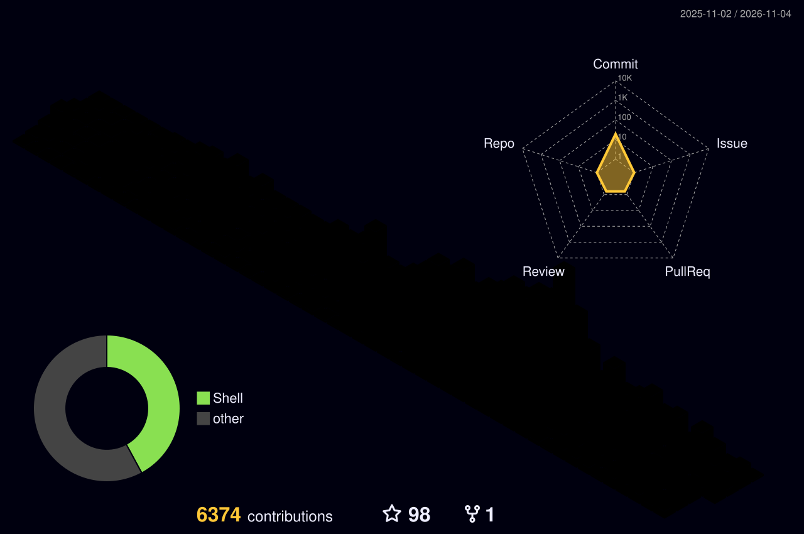

  

  

  <b>🌐 Language / 語言：</b>
  <a href="README.md">🇬🇧 English</a> ｜ <a href="README.zh-TW.md">🇹🇼 繁體中文</a>

  <h2>👋 你好，我是 PCKuo</h2>

  <h3>🤖 AI 與 Agent 工作流</h3>
  
  
  
  
  
  

  <h3>⭐ 精選專案</h3>
  
  
<i>賦予你的 AI Agent 完整的 Telegram Bot 超能力——一個支援豐富鍵盤、本地檔案、媒體相簿與互動元件的 MCP 伺服器。</i>

  
<code>uvx mcp-telegram-agent</code>

  
  
  

  
🔧 技術堆疊

   
  

    
    
    
    
  

  <h3>📊 GitHub 統計</h3>
  

  

  <h3>🏆 成就獎盃</h3>
  

  

  

